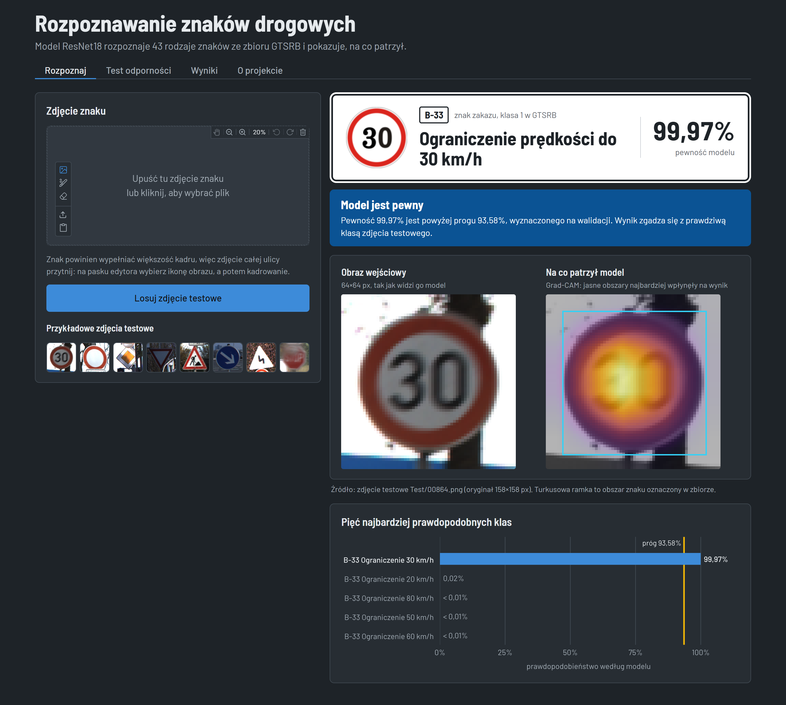
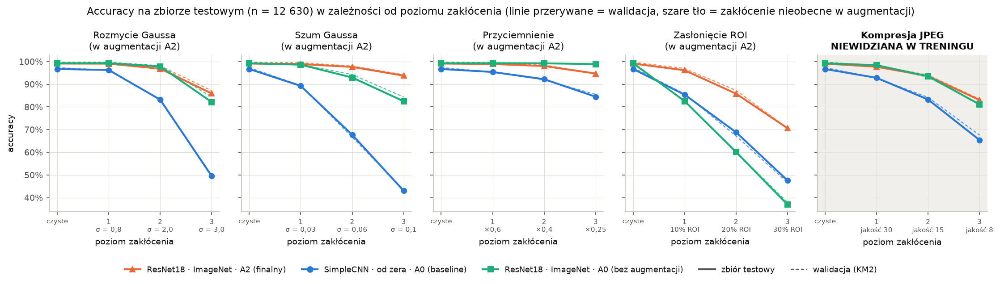
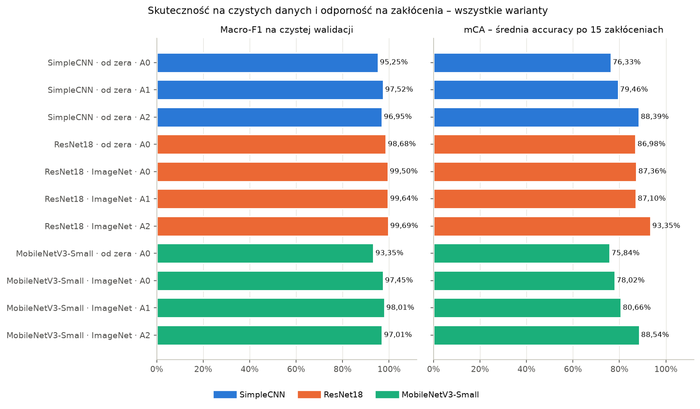
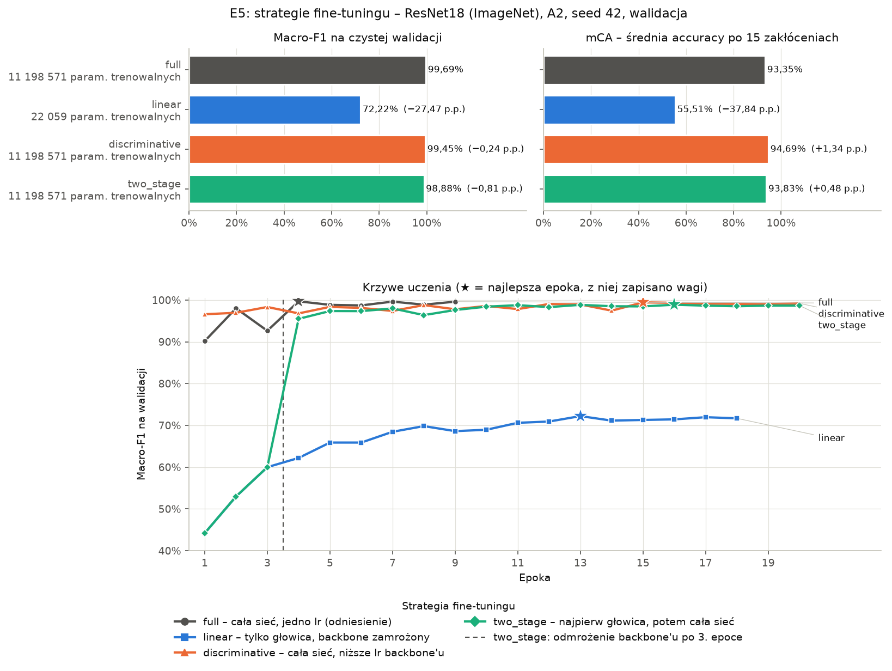
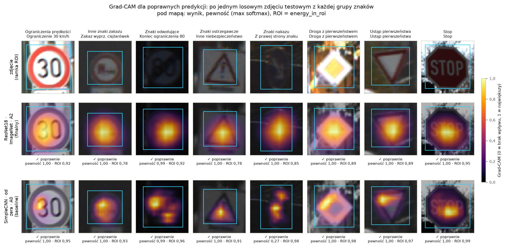
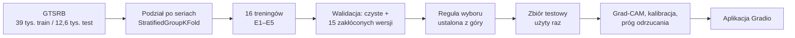
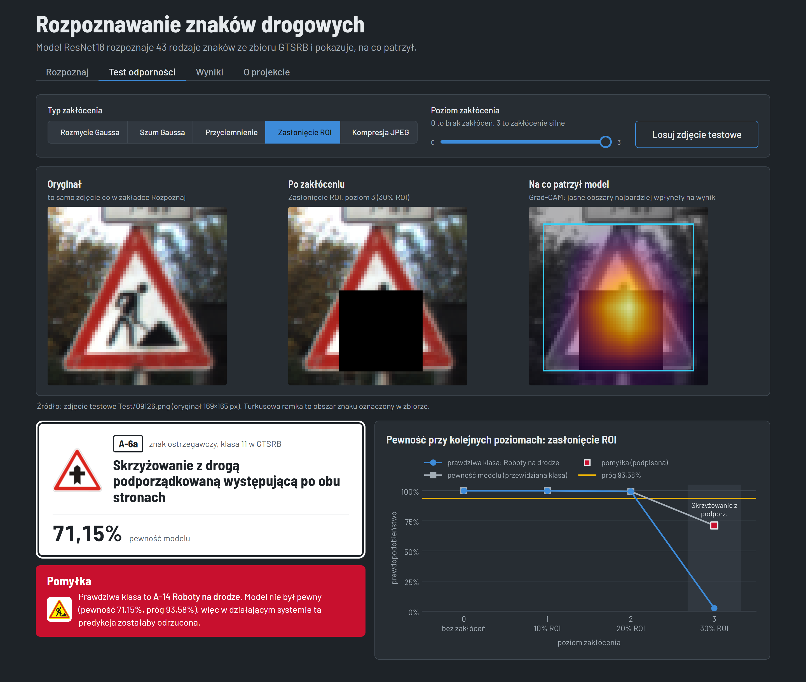

# Rozpoznawanie znaków drogowych odporne na złe warunki

**Ile traci konwolucyjny klasyfikator znaków drogowych, gdy obraz jest rozmyty, zaszumiony, ciemny, częściowo zasłonięty albo mocno skompresowany? I co go przed tym chroni: uczenie transferowe, augmentacja danych czy większa sieć?**

W projekcie wytrenowałem i porównałem sieci konwolucyjne (16 treningów) na zbiorze [GTSRB](https://www.ini.rub.de/upload/file/1470692848_f03494010c16c36bab9e/StallkampEtAl_GTSRB_IJCNN2011.pdf) (43 klasy niemieckich znaków, ok. 52 tys. zdjęć). Zmierzyłem ich odporność na 15 kontrolowanych zakłóceń obrazu, wyjaśniłem decyzje finalnego modelu za pomocą Grad-CAM i skalibrowanej pewności, a całość zamknąłem w interaktywnej aplikacji Gradio.



<sub>Python, PyTorch, torchvision, scikit-learn, pytorch-grad-cam, Gradio. Projekt zaliczeniowy z przedmiotu *Sztuczna inteligencja w systemach informatycznych*. Pełne sprawozdanie jest w [`reports/`](reports/).</sub>

---

## Najważniejsze wyniki

- **Finalny model:** ResNet18 pretrenowany na ImageNet, dostrojony z augmentacją odpornościową. Na odłożonym zbiorze testowym ma **99,1% accuracy** na czystych zdjęciach i **92,7% średniej accuracy na 15 zakłóceniach** (prosty baseline: 96,7% i 76,3%).
- **O odporności bardziej decyduje augmentacja niż architektura.** Sieć z 0,29 mln parametrów i dobrą augmentacją jest bardziej odporna niż pretrenowany ResNet18 (38 razy większy) uczony bez niej.
- **Przy zasłonięciu 30% znaku** finalny model rozpoznaje 70,6% znaków, a ta sama sieć bez augmentacji odpornościowej tylko 36,9%.
- **Odporność nie przenosi się na nowe zakłócenie.** Kompresji JPEG nie było w treningu i tam augmentacja pomogła tylko o 0,5 p.p.
- **Sposób fine-tuningu ma znaczenie.** Uczenie samej ostatniej warstwy daje tylko 72% macro-F1. Najbardziej odporny model w projekcie dał 10 razy niższy learning rate dla pretrenowanej części sieci.
- **Model wie, kiedy nie wie.** Jego pewność jest dobrze skalibrowana (ECE 0,43%). Próg pewności wybrany na walidacji wyłapuje 92% pomyłek i przepuszcza 96,6% czystych zdjęć.
- **Rzetelna metodologia:** podział danych po seriach bez wycieku, reguła wyboru modelu spisana przed treningami, deterministyczne zakłócenia, 3 seedy dla zwycięzcy i zbiór testowy użyty dokładnie raz, zablokowany w kodzie.

## Wyniki

### Ocena końcowa na zbiorze testowym (12 630 zdjęć, użyty raz)

| Model | Accuracy (czyste) | Macro-F1 (czyste) | mCA (15 zakłóceń) | Względny spadek |
|---|---|---|---|---|
| **ResNet18, ImageNet, augmentacja odpornościowa (finalny)** | 99,13% | 98,44% | **92,72%** | **6,5%** |
| ResNet18, ImageNet, bez augmentacji | 99,26% | 99,00% | 86,89% | 12,5% |
| SimpleCNN (baseline), bez augmentacji | 96,72% | 94,64% | 76,30% | 21,1% |

*mCA (mean corruption accuracy) to średnia accuracy po 5 typach zakłóceń × 3 poziomach nasilenia. Względny spadek = (accuracy na czystych − mCA) / accuracy na czystych.*

| Zakłócenie (średnia z 3 poziomów) | Finalny | ResNet18 bez aug. | Baseline |
|---|---|---|---|
| Rozmycie Gaussa | 94,0% | 93,1% | 76,3% |
| Szum Gaussa | 96,8% | 91,4% | 66,7% |
| Przyciemnienie | 97,2% | 99,1% | 90,7% |
| Zasłonięcie (wewnątrz znaku) | **84,2%** | 59,9% | 67,3% |
| Kompresja JPEG (niewidziana w treningu) | 91,5% | 91,0% | 80,5% |



Przewaga w odporności zmierzona na walidacji (+6,0 p.p. mCA) niemal dokładnie powtórzyła się na teście (+5,8 p.p.). Kosztem augmentacji jest około 0,6 p.p. macro-F1 na czystych zdjęciach.

### Co pokazały eksperymenty (zbiór walidacyjny)

| Eksperyment | Pytanie | Odpowiedź |
|---|---|---|
| **E1** architektura i transfer | Czy wagi z ImageNet pomagają? | Tak, na czystych danych (+0,8 p.p. macro-F1 dla ResNet18, +4,1 p.p. dla MobileNetV3) i ze znacznie szybszą zbieżnością. **Nie** poprawiają odporności. |
| **E2/E3** augmentacja | Która augmentacja daje odporność? | Geometryczna (obroty, przesunięcia, jasność) prawie nic nie zmienia. Odpornościowa (rozmycie, szum, przyciemnienie, wymazywanie fragmentów) dodaje od 6 do 9 p.p. mCA w każdej architekturze. |
| **E1–E3** rozmiar modelu | Czy MobileNetV3-Small dorównuje ResNet18? | Nie: −1,7 p.p. macro-F1 i −4,8 p.p. mCA, choć jest 7 razy mniejszy i ok. 5 razy szybszy na CPU. |
| **E4** stabilność | Czy zwycięzca to szczęśliwy przebieg? | Nie. Na 3 seedach: macro-F1 99,73 ± 0,07%, mCA 94,96 ± 1,55%. Przebiegi zatrzymane później były bardziej odporne. |
| **E5** strategia fine-tuningu | Czy wystarczy podmienić ostatnią warstwę? | Nie (szczegóły poniżej). |



**E5: strategie fine-tuningu** (ResNet18, ImageNet, augmentacja odpornościowa, walidacja):

| Strategia | Co jest uczone | Macro-F1 | mCA |
|---|---|---|---|
| `full` (użyta w finalnym modelu) | cała sieć, jeden learning rate (1e-3) | **99,69%** | 93,35% |
| `linear` | tylko głowica, reszta sieci zamrożona | 72,22% | 55,51% |
| `discriminative` | cała sieć, backbone lr 1e-4, głowica lr 1e-3 | 99,45% | **94,69%** |
| `two_stage` | 3 epoki sama głowica, potem jak `discriminative` | 98,88% | 93,83% |

Cechy z ImageNet liczone na obrazach 64×64 (po zmianie stride) nie pasują do znaków drogowych bez dostrojenia, więc trzeba uczyć też wcześniejsze warstwy. Mniejszy krok dla pretrenowanej części sieci dał najwyższą odporność, głównie przy zasłonięciu (+4,9 p.p.). To jeden seed, a zysk mieści się w rozrzucie między seedami z E4, więc traktuję go jako wskazówkę, a nie dowód. E5 przeprowadziłem już po ocenie na teście, dlatego wyniki są tylko z walidacji, a finalny model się nie zmienił.



### Wyjaśnialność i pewność

- **Grad-CAM** (mapy 8×8 dzięki zmianie stride) pokazuje, że finalny model patrzy na piktogram w środku znaku. 88% mapy Grad-CAM leży wewnątrz ramki znaku, wobec 56% dla mapy równomiernej.
- **Pomyłki to podobne znaki, a nie rozproszenie uwagi.** Przy błędnych predykcjach uwaga dalej jest na znaku (85%). Najczęściej mylone są trójkątne znaki ostrzegawcze, które różni tylko piktogram o wielkości kilkunastu pikseli (np. *nierówna droga → roboty na drodze*). Ograniczenia prędkości, różniące się tylko cyframi, są rozpoznawane prawie bezbłędnie.
- **Próg odrzucania:** to najniższa pewność, przy której zachowane predykcje na zakłóconej walidacji mają co najmniej 99,5% trafień. Wyszło 0,936. Na teście próg zachowuje 96,6% czystych zdjęć z trafnością 99,93% i odrzuca 91,7% błędów. Przy zasłonięciu model częściej przyznaje się do niepewności (31%), zamiast zgadywać.



## Jak to działa



**Dane.** Zbiór treningowy składa się z 1 307 *serii*, czyli nagrań tego samego fizycznego znaku po ok. 30 niemal identycznych klatek. Losowy podział po zdjęciach wrzuciłby kopie tego samego znaku do treningu i walidacji, dlatego dzielę dane po seriach (`StratifiedGroupKFold`, 20% serii na walidację, każda klasa reprezentowana). Zdjęcia skaluję do 64×64, bo mediana szerokości znaku to 43 px. Główną metryką jest macro-F1, bo liczności klas różnią się nawet 11 razy.

**Modele.** Własna 3-blokowa SimpleCNN (baseline, 0,29 mln parametrów), ResNet18 (11,2 mln) i MobileNetV3-Small (1,6 mln), każdy uczony od zera albo z wagami ImageNet. Obie sieci z torchvision dostosowałem do wejścia 64×64: krok pierwszej konwolucji ustawiłem na 1, a w ResNet18 usunąłem max pooling. Ostatnia mapa cech ma wtedy 8×8 albo 4×4 zamiast 2×2, co ma znaczenie dla Grad-CAM. Wagi pretrenowane nadal ładują się bez zmian.

**Augmentacja.** A0: brak. A1: geometryczna (obrót ±10°, przesunięcie, skala, jasność i kontrast). A2: A1 plus losowe rozmycie, przyciemnienie, szum Gaussa i wymazanie fragmentu (każde z p = 0,3). Nie ma odbić lustrzanych, bo zamieniają „nakaz skrętu w prawo” w „w lewo”. Nie ma też JPEG, bo zostawiłem go jako zakłócenie, którego model nie widział. A2 dobrałem na podstawie statystyk danych, zanim wytrenowałem pierwszy model: 14% zdjęć jest bardzo ciemnych i mocniejsze przyciemnienie całkowicie je wymazywało.

**Zakłócenia.** Rozmycie Gaussa, szum Gaussa, przyciemnienie, zasłonięcie (czarny prostokąt wewnątrz ramki znaku) i kompresja JPEG, każde w 3 poziomach. Zakłócenia są deterministyczne dla każdej trójki (zdjęcie, typ, poziom), więc każdy model widzi dokładnie te same piksele.

**Trening.** AdamW (lr 1e-3, weight decay 1e-4), harmonogram cosinusowy, batch 128, maks. 20 epok, early stopping na macro-F1 walidacji (cierpliwość 5), mieszana precyzja bf16 z channels-last i cache zdjęć w RAM (epoka z 70 s do 13 s na Windowsie). Każdy trening jest w pełni opisany plikiem YAML i zapisuje historię, metryki i wykresy w `results/<run>/`.

**Wybór modelu** (ustalony przed treningami): odrzucam warianty o więcej niż 1 p.p. słabsze od najlepszego macro-F1, z pozostałych biorę najwyższe mCA, a przy różnicy poniżej 0,5 p.p. wygrywa mniejszy model. Skrypt sam stosuje tę regułę i zapisuje uzasadnienie w `results/e4_selection.json`.

## Aplikacja

`python -m app.app` uruchamia lokalną aplikację Gradio z czterema zakładkami:

- **Rozpoznaj:** wgranie i przycięcie zdjęcia albo wybór zdjęcia testowego. Pokazuje rozpoznany znak z polską nazwą i kodem, pewność, top-5 klas i mapę Grad-CAM. Niebieski pasek oznacza pewny wynik, żółty wynik poniżej progu odrzucania, a czerwony pomyłkę na zdjęciu testowym ze znaną etykietą.
- **Test odporności:** jedno z 5 zakłóceń z suwakiem siły i podgląd na żywo, jak zmieniają się predykcja, mapa uwagi i pewność. Dla zdjęć testowych zakłócone piksele są identyczne z tymi z ewaluacji.
- **Wyniki:** wszystkie tabele i wykresy z eksperymentów.
- **O projekcie:** krótki opis i ograniczenia.



## Ograniczenia

- To **klasyfikator, a nie detektor**: oczekuje wycinka ze znakiem na środku. Pełne zdjęcie ulicy ze znakiem STOP rozpoznaje jako „zakaz wjazdu” (95,5%), a przycięty znak już poprawnie (99,9%).
- **Przesunięcie dziedziny:** model zna tylko zdjęcia niemieckich znaków z kamery samochodowej. Wzorcowe rysunki znaków rozpoznaje poprawnie tylko w 30 na 43 przypadkach, a polskich znaków (np. z żółtym tłem ostrzegawczych) nie testowałem.
- Część pomyłek na bardzo ciemnych zdjęciach ma pewność bliską 100%, więc żaden próg ich nie wyłapie.
- Sztuczne zakłócenia są tylko przybliżeniem prawdziwych warunków, a odporność objęła głównie te typy zakłóceń, które były w treningu.
- Early stopping na czystym macro-F1 nie nagradza odporności. E4 i E5 sugerują, że dłuższy trening albo kryterium uwzględniające odporność dałyby bardziej odporny model.

## Struktura repozytorium

```
├── src/
│   ├── data.py             # wczytywanie CSV, podział po seriach, augmentacje, Dataset z cache
│   ├── models.py           # SimpleCNN, ResNet18, MobileNetV3-Small dostosowane do 64×64
│   ├── corruptions.py      # 5 zakłóceń × 3 poziomy, deterministycznie
│   ├── train.py            # trening z pliku YAML, strategie fine-tuningu, early stopping
│   ├── evaluate.py         # metryki na czystych i zakłóconych danych, czas na CPU; test zablokowany flagą
│   ├── run_experiments.py  # etapy E1–E5 i reguła wyboru modelu
│   ├── summarize.py        # tabela zbiorcza i wykresy
│   ├── final_eval.py       # jednorazowa ocena na zbiorze testowym
│   ├── xai.py              # Grad-CAM, udział uwagi w ramce znaku, kalibracja, próg odrzucania
│   └── class_names_pl.py   # polskie nazwy i kody znaków dla aplikacji
├── app/app.py              # aplikacja Gradio
├── configs/                # jeden plik YAML na trening
├── splits/val_tracks.json  # zapisany podział train/val
├── notebooks/01_eda.ipynb  # analiza eksploracyjna danych
├── results/                # metryki (JSON/CSV) i wykresy każdego treningu, zestawienia, test, XAI
├── reports/                # pełne sprawozdanie i sprawozdania z kamieni milowych (PDF)
└── docs/img/               # zrzuty ekranu aplikacji
```

## Uruchomienie

### 1. Środowisko

Python 3.12. Najpierw PyTorch dopasowany do sprzętu, potem reszta:

```bash
python -m venv .venv
# Windows: .venv\Scripts\activate    Linux/macOS: source .venv/bin/activate

# karta NVIDIA (build CUDA 13.2, użyty w projekcie):
pip install torch==2.14.1 torchvision==0.29.1 --index-url https://download.pytorch.org/whl/cu132
# albo tylko CPU:
pip install torch==2.14.1 torchvision==0.29.1 --index-url https://download.pytorch.org/whl/cpu

pip install -r requirements.txt
```

### 2. Dane

Pobierz GTSRB z [Kaggle](https://www.kaggle.com/datasets/meowmeowmeowmeowmeow/gtsrb-german-traffic-sign) i rozpakuj do `data/`, tak żeby istniały `data/Train/`, `data/Test/`, `data/Meta/` oraz `data/Train.csv` i `data/Test.csv`. Katalog `data/` jest w `.gitignore`.

### 3. Aplikacja z wytrenowanym modelem

Wag modelu nie ma w repozytorium (45 MB). Pobierz `best.pt` z [najnowszego wydania](../../releases/latest) do `results/resnet18_pretrained_A2/` albo wytrenuj finalny model samodzielnie (ok. 6 minut na RTX 4070 Laptop):

```bash
python -m src.train --config configs/resnet18_pretrained_A2.yaml
python -m app.app                 # http://127.0.0.1:7860
python -m app.app --device cpu    # bez karty graficznej; ok. 0,1 s na predykcję z Grad-CAM
```

Bez `data/Test/` aplikacja działa dalej, ale tylko z własnymi, wgranymi zdjęciami.

### 4. Odtworzenie całego badania

```bash
python -m src.data                               # utworzenie/sprawdzenie podziału po seriach
python -m src.run_experiments --stage all        # E1–E5: treningi, walidacja, wybór, seedy (ok. 2,5 h na laptopowym GPU)
python -m src.summarize                          # tabele i wykresy -> results/summary/
python -m src.final_eval                         # jednorazowa ocena na teście -> results/final_test/
python -m src.xai                                # Grad-CAM, kalibracja, próg odrzucania -> results/xai/
```

Każde polecenie pomija gotowe treningi, więc przerwany przebieg można wznowić. Flaga `--smoke` uruchamia szybki test (1 epoka, mały podzbiór, wyniki w ignorowanym przez gita `results/_smoke/`). Ocena na zbiorze testowym wymaga jawnej flagi `--i-know-this-is-final` (`final_eval` ustawia ją sam).

## Licencja

Kod jest udostępniony na licencji [MIT](LICENSE). Zbiór GTSRB ma własne warunki użycia i nie jest częścią repozytorium.

## Bibliografia

- J. Stallkamp, M. Schlipsing, J. Salmen, C. Igel. *The German Traffic Sign Recognition Benchmark: a multi-class classification competition.* IJCNN 2011.
- K. He i in. *Deep Residual Learning for Image Recognition.* CVPR 2016.
- A. Howard i in. *Searching for MobileNetV3.* ICCV 2019.
- D. Hendrycks, T. Dietterich. *Benchmarking Neural Network Robustness to Common Corruptions and Perturbations.* ICLR 2019.
- R. R. Selvaraju i in. *Grad-CAM: Visual Explanations from Deep Networks via Gradient-based Localization.* ICCV 2017.
- C. Guo i in. *On Calibration of Modern Neural Networks.* ICML 2017.
- J. Howard, S. Ruder. *Universal Language Model Fine-tuning for Text Classification.* ACL 2018.
- A. Kumar i in. *Fine-Tuning can Distort Pretrained Features and Underperform Out-of-Distribution.* ICLR 2022.
