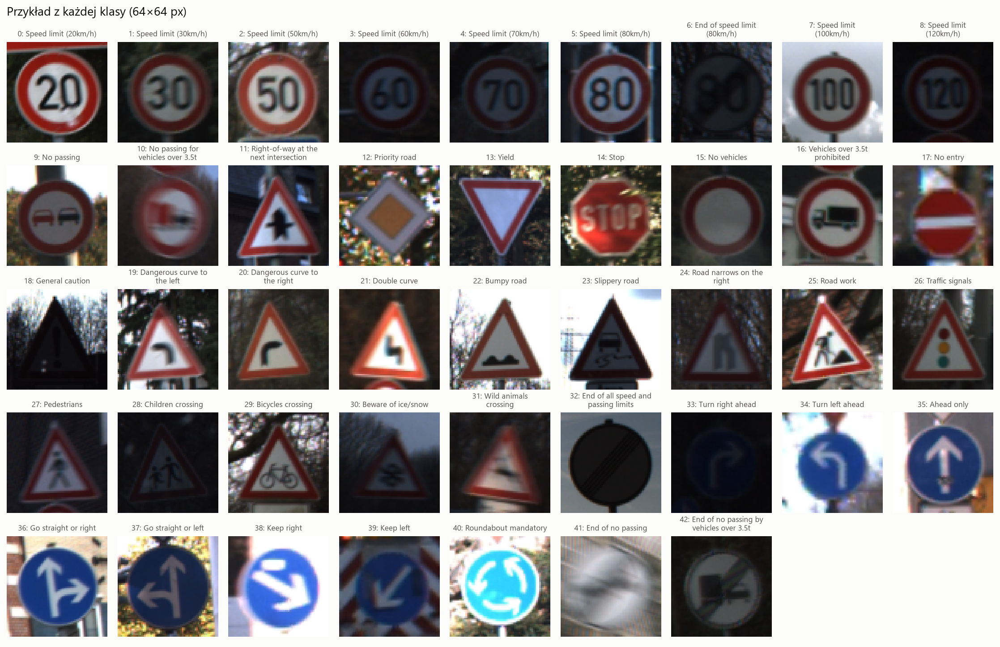
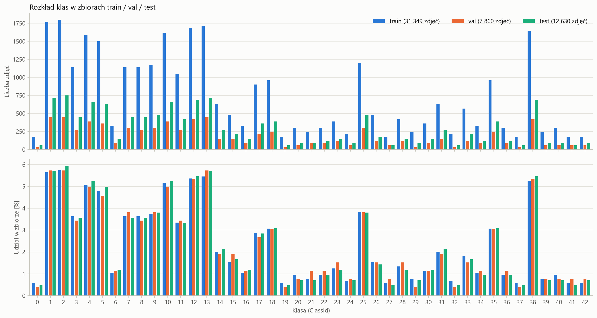
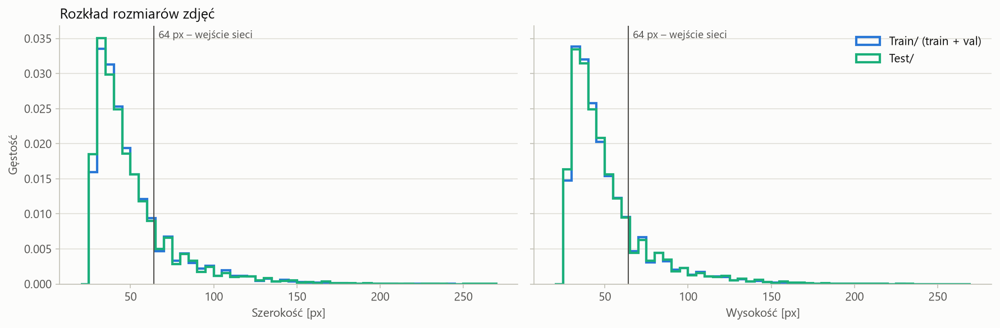
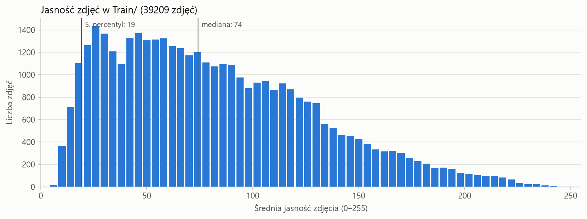
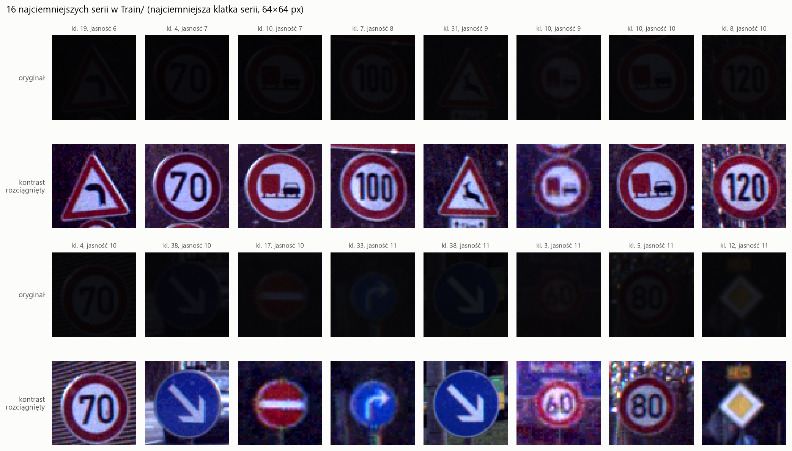
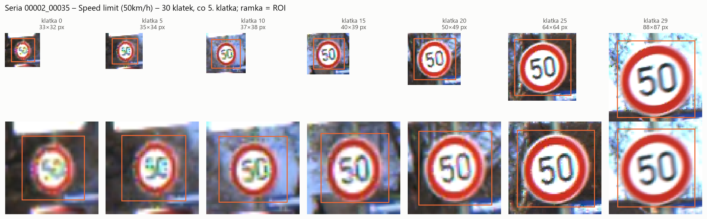
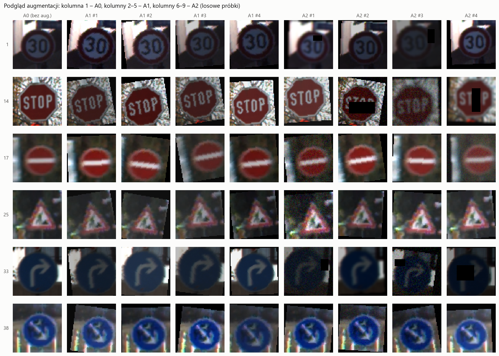

# Sprawozdanie KM1: definicja problemu, dobór danych i projekt eksperymentu

| | |
| --- | --- |
| Przedmiot | Sztuczna inteligencja w systemach informatycznych |
| Temat projektu | Rozpoznawanie znaków drogowych z wykorzystaniem konwolucyjnych sieci neuronowych oraz analiza odporności modeli na zakłócenia obrazu |
| Etap | Kamień milowy 1: definicja problemu, dobór danych i projekt eksperymentu |
| Autor | Bartosz Pajda |
| Data | 28.10.2026 |
| Repozytorium | [github.com/BPajda/GTSRB_robustness](https://github.com/BPajda/GTSRB_robustness) |

## 1. Wprowadzenie i cel projektu

Automatyczne rozpoznawanie znaków drogowych to jeden z podstawowych elementów systemów wspomagania kierowcy. Kamera w samochodzie nie zawsze dostaje jednak idealny obraz. Zdjęcie bywa rozmyte przez ruch pojazdu, zaszumione przy słabym świetle, ciemne o zmierzchu, a sam znak może być częściowo zasłonięty przez gałąź albo naklejkę.

Na standardowym zbiorze GTSRB współczesne sieci konwolucyjne osiągają skuteczność na poziomie około 99%, więc sama klasyfikacja czystych zdjęć nie jest już ciekawym problemem badawczym. Dużo ciekawsze jest pytanie, co dzieje się z taką skutecznością, gdy warunki robią się trudniejsze. Dlatego projekt koncentruje się na odporności modeli.

**Pytanie badawcze:** czy uczenie transferowe i odpowiednio dobrana augmentacja danych ograniczają spadek skuteczności klasyfikatora znaków drogowych na zakłóconych zdjęciach?

Odpowiedź będzie oparta na liczbach. Porównamy kilka wariantów sieci na czystych danych i na danych celowo zakłóconych w kontrolowany sposób, a następnie sprawdzimy, które decyzje projektowe faktycznie zmniejszają spadek skuteczności.

Projekt składa się z trzech etapów:

1. **KM1 (to sprawozdanie):** zdefiniowanie problemu, wybór i analiza zbioru danych, przygotowanie danych oraz zaplanowanie eksperymentów.
2. **KM2:** implementacja modeli, trening i porównanie wariantów zgodnie z planem z KM1.
3. **KM3:** ocena finalnego modelu na zbiorze testowym, warstwa wyjaśnialności (XAI) oraz aplikacja demonstracyjna.

Celem tego etapu jest więc odpowiedź na pytanie: co dokładnie chcemy sprawdzić i w jaki sposób udowodnimy, że rozwiązanie działa. Wszystkie kolejne decyzje w KM2 i KM3 wynikają z ustaleń zapisanych poniżej.

## 2. Zbiór danych

W projekcie wykorzystano zbiór **GTSRB** (German Traffic Sign Recognition Benchmark), przygotowany na konkurs IJCNN 2011 przez zespół z Ruhr-Universität Bochum [1]. Zdjęcia pochodzą z nagrań wideo wykonanych kamerą samochodową na niemieckich drogach. Każde zdjęcie przedstawia jeden znak wycięty z klatki filmu wraz z niewielkim marginesem tła. Dane pobrano z serwisu Kaggle [2], gdzie zbiór jest udostępniony w postaci gotowych plików PNG z opisem w plikach CSV.

| Element | Zawartość |
| --- | --- |
| `Train/` | 39 209 zdjęć treningowych w 43 podfolderach (jeden na klasę) |
| `Test/` | 12 630 zdjęć testowych |
| `Train.csv`, `Test.csv` | rozmiar zdjęcia, współrzędne ramki ze znakiem (ROI), numer klasy, ścieżka do pliku |
| `Meta/` | wzorcowe piktogramy wszystkich 43 klas |

### Dlaczego ten zbiór

- **Wiarygodność:** to uznany benchmark opisany w recenzowanej publikacji, wykorzystywany w wielu pracach naukowych. Etykiety zostały nadane i zweryfikowane ręcznie.
- **Wielkość:** ponad 51 tysięcy zdjęć i 43 klasy to wystarczająco dużo, żeby rzetelnie porównywać architektury, a jednocześnie na tyle mało, żeby trening na zwykłym komputerze trwał minuty, a nie godziny.
- **Oficjalny podział na trening i test:** zbiór testowy pochodzi z innych nagrań niż treningowy, więc daje uczciwą ocenę końcową.
- **Naturalnie trudne przypadki:** zdjęcia są robione w różnych warunkach oświetleniowych i z różnej odległości, więc temat odporności ma tu realne uzasadnienie.
- **Ramki ROI:** dla każdego zdjęcia znane jest dokładne położenie znaku. Wykorzystamy to w KM3 do ilościowej oceny, czy model przy podejmowaniu decyzji patrzy na znak, czy na tło.

Zbiór testowy został od początku odłożony na bok. W całym KM1 korzystaliśmy wyłącznie z etykiet i rozmiarów zapisanych w `Test.csv`, żeby porównać rozkłady klas. Same zdjęcia testowe zostaną użyte dopiero w KM3, jednorazowo, do oceny finalnego modelu.

## 3. Analiza eksploracyjna danych

Analizę przeprowadzono w notebooku `notebooks/01_eda.ipynb`. Wszystkie wykresy i liczby zostały zapisane w katalogu `results/eda/`. Poniżej omówiono najważniejsze obserwacje i to, jaki mają wpływ na dalsze decyzje projektowe.

### 3.1. Przegląd klas

Zbiór obejmuje 43 klasy znaków: ograniczenia prędkości, zakazy, nakazy, znaki ostrzegawcze oraz znaki informacyjne. Część klas jest do siebie bardzo podobna, przede wszystkim ograniczenia prędkości (20, 30, 50, 60, 70, 80, 100 i 120 km/h), które różnią się tylko cyframi w środku tego samego czerwonego okręgu. Spodziewamy się, że to właśnie między nimi pojawi się najwięcej pomyłek.



*Rys. 1. Przykładowe zdjęcie z każdej z 43 klas.*

### 3.2. Liczność klas

Zbiór jest wyraźnie niezbalansowany. Najrzadsza klasa (0, ograniczenie do 20 km/h) ma 210 zdjęć treningowych, a najliczniejsza (2, ograniczenie do 50 km/h) aż 2 250. Stosunek wynosi około 10,7 do 1. Rozkład w zbiorze testowym ma niemal identyczny kształt (od 60 do 750 zdjęć na klasę).



*Rys. 2. Liczba zdjęć (góra) oraz udział procentowy (dół) każdej klasy w zbiorze treningowym, walidacyjnym i testowym.*

**Wniosek:** samo accuracy faworyzuje duże klasy, bo model może mieć wysoki wynik ogólny i jednocześnie mylić rzadkie znaki. Dlatego główną metryką porównawczą w projekcie będzie **macro-F1**, które traktuje każdą klasę z tą samą wagą.

### 3.3. Rozmiary zdjęć

Zdjęcia mają od 25 do około 250 pikseli szerokości, a mediana wynosi 43 px. Proporcje są bliskie 1:1 (mediana stosunku szerokości do wysokości to dokładnie 1,0). Około 79% zdjęć ma oba boki mniejsze niż 64 px.



*Rys. 3. Rozkład szerokości i wysokości zdjęć.*

**Wniosek:** wszystkie zdjęcia sprowadzamy do wspólnego rozmiaru **64×64 px**. Dla większości danych oznacza to lekkie powiększenie, więc nie tracimy informacji, a jednocześnie rozdzielczość jest wystarczająca dla sieci pretrenowanych i trening pozostaje szybki. Ze względu na proporcje bliskie 1:1 przeskalowanie praktycznie nie zniekształca znaków.

### 3.4. Jasność

Mediana średniej jasności zdjęcia wynosi 74 w skali 0 do 255, czyli zbiór jest raczej ciemny. Około 14% zdjęć ma średnią jasność poniżej 30, a 30% poniżej 50. Najciemniejsze przykłady są dla człowieka trudne do rozpoznania.



*Rys. 4. Rozkład średniej jasności zdjęć treningowych.*



*Rys. 5. Przykłady najciemniejszych zdjęć w zbiorze treningowym.*

**Wniosek:** ciemne zdjęcia są w GTSRB czymś naturalnym, a nie wyjątkiem. Ma to dwie konsekwencje. Po pierwsze, augmentacja przyciemniająca nie może być zbyt mocna, bo nałożona na już ciemne zdjęcie potrafi całkowicie wymazać znak (rozdział 4.3). Po drugie, zakłócenie „przyciemnienie” używane do oceny odporności musi być na tyle silne, żeby wychodzić poza to, co model i tak widzi w danych treningowych (rozdział 5.4).

### 3.5. Serie zdjęć tego samego znaku

To najważniejsza obserwacja całej analizy. Zbiór treningowy składa się z **1 307 serii** (tracków). Każda seria to około 30 kolejnych klatek nagrania przedstawiających ten sam fizyczny znak, coraz większy w miarę zbliżania się samochodu. Numer serii jest zapisany w nazwie pliku (`<klasa>_<seria>_<klatka>.png`). Liczba serii na klasę waha się od 7 do 75.



*Rys. 6. Co piąta klatka jednej serii (ograniczenie do 50 km/h). Górny rząd pokazuje oryginalne rozmiary, dolny po przeskalowaniu do 64×64 px. Pomarańczowa ramka to ROI.*

**Wniosek:** sąsiednie klatki jednej serii są niemal identyczne. Gdybyśmy wydzielali zbiór walidacyjny losowo po pojedynczych zdjęciach, praktycznie te same obrazy trafiłyby jednocześnie do treningu i walidacji, a wynik walidacji byłby sztucznie zawyżony. Dlatego podział danych wykonujemy **po seriach** (rozdział 4.1).

### 3.6. Ramki ROI

Każde zdjęcie ma w plikach CSV współrzędne ramki obejmującej znak. Typowy margines między ramką a krawędzią zdjęcia to około 5 px z każdej strony. Po przeskalowaniu do 64×64 px ramki nadal dokładnie obejmują znak, co widać na rys. 6. Ramki zostaną wykorzystane w KM3 do policzenia, jaka część uwagi modelu (mapy Grad-CAM) przypada na sam znak, a jaka na tło.

## 4. Przygotowanie danych

Cała logika przygotowania danych znajduje się w module `src/data.py`. Dzięki temu każdy eksperyment w KM2 korzysta z dokładnie tego samego podziału, przetwarzania i augmentacji.

### 4.1. Podział na zbiór treningowy i walidacyjny

Zbiór walidacyjny wydzielono z oficjalnego zbioru treningowego. Zgodnie z wnioskiem z rozdziału 3.5 podział wykonano po seriach, czyli każda seria trafia w całości albo do treningu, albo do walidacji. Użyto metody `StratifiedGroupKFold` z biblioteki scikit-learn (5 foldów, grupy to serie, stratyfikacja po klasie, ziarno losowości 42). Jeden fold, czyli około 20% serii, stanowi zbiór walidacyjny. Stratyfikacja zapewnia, że proporcje klas w walidacji odpowiadają proporcjom w treningu.

| Zbiór | Zdjęcia | Serie | Przeznaczenie |
| --- | --- | --- | --- |
| Treningowy | 31 349 | 1 045 | uczenie modeli |
| Walidacyjny | 7 860 | 262 | wybór wariantu, early stopping, ocena odporności w KM2 |
| Testowy | 12 630 | brak danych o seriach | jednorazowa ocena finalnego modelu w KM3 |

Wyniki kontroli poprawności podziału:

- zbiory treningowy i walidacyjny nie mają żadnej wspólnej serii,
- w walidacji występują wszystkie 43 klasy, każda z co najmniej 30 zdjęciami,
- największa różnica udziału klasy między treningiem a walidacją wynosi 0,38 punktu procentowego,
- podział jest deterministyczny: lista serii walidacyjnych zapisana w pliku `splits/val_tracks.json` jest wersjonowana w repozytorium i wczytywana przez wszystkie skrypty.

**Ograniczenie:** klasy 0, 19, 29, 32 i 37 mają w walidacji tylko po jednej serii, więc ich wynik walidacyjny opiera się na jednym fizycznym znaku. Wynika to z małej liczby serii w tych klasach (od 7 serii wzwyż). Wyniki walidacyjne dla pojedynczych klas będziemy więc traktować ostrożnie, a rzetelny obraz da dopiero zbiór testowy, w którym tych klas jest więcej.

### 4.2. Przetwarzanie wstępne

Każde zdjęcie przechodzi te same kroki:

1. konwersja do RGB,
2. przeskalowanie do 64×64 px z antyaliasingiem,
3. zamiana na tensor o wartościach z przedziału [0, 1],
4. normalizacja średnią i odchyleniem standardowym ze zbioru ImageNet.

Normalizację ImageNet stosujemy dla wszystkich modeli, także dla własnej sieci uczonej od zera. Dzięki temu jedyną różnicą między wariantami jest architektura i sposób inicjalizacji wag, a nie przetwarzanie danych. Ramki ROI są przeskalowywane razem ze zdjęciem.

Podczas testów okazało się, że na Windowsie wczytywanie plików PNG jest wąskim gardłem (około 70 s na epokę bez augmentacji). Dodano więc opcję jednorazowego zdekodowania i przeskalowania wszystkich zdjęć do pamięci RAM. Wynik jest identyczny co do bitu, a czas epoki spadł do około 13 s. To ważne dla KM2, bo zaplanowanych treningów jest kilkanaście.

### 4.3. Augmentacja danych

Zdefiniowano trzy poziomy augmentacji, które będą porównywane w KM2:

| Poziom | Operacje |
| --- | --- |
| **A0** brak | tylko przetwarzanie wstępne (ten sam zestaw służy do walidacji i testu) |
| **A1** geometryczna | A0 + losowy obrót ±10°, przesunięcie do 10%, skalowanie 0,9 do 1,1, zmiana jasności i kontrastu ±30% |
| **A2** odpornościowa | A1 + z prawdopodobieństwem 0,3 każda: rozmycie Gaussa (σ 0,1 do 1,5), przyciemnienie (×0,5 do 0,9), szum Gaussa (σ 0,01 do 0,05), wymazanie prostokątnego fragmentu (2% do 15% powierzchni) |

Dwie decyzje wymagają komentarza:

- **Brak odbić lustrzanych.** Odbicie to bardzo popularna augmentacja, ale w przypadku znaków drogowych zmienia ich znaczenie. Odbity nakaz skrętu w prawo staje się nakazem skrętu w lewo, czyli zdjęcie dostaje błędną etykietę.
- **Osłabienie A2 na podstawie EDA.** W pierwszej wersji A2 przyciemniała zdjęcia nawet do 30% jasności i dodawała szum o σ do 0,08. Podgląd augmentacji pokazał, że na zdjęciach już ciemnych (14% zbioru) znak bywał wtedy całkowicie nieczytelny, a model uczyłby się na obrazach, których nie da się rozpoznać. Zakresy zmniejszono do wartości podanych w tabeli. Decyzję podjęto przed wytrenowaniem jakiegokolwiek modelu, wyłącznie na podstawie analizy danych, żeby nie dopasowywać augmentacji do wyników.



*Rys. 7. Podgląd augmentacji po korekcie. Kolumna 1 to A0, kolumny 2 do 5 to losowe próbki A1, kolumny 6 do 9 to losowe próbki A2.*

Żadna augmentacja nie zawiera kompresji JPEG. Jest to celowe, bo JPEG posłuży w KM2 jako zakłócenie, którego model nigdy nie widział podczas treningu (hipoteza H4).

## 5. Projekt eksperymentu

Plan eksperymentów został ustalony w całości przed rozpoczęciem treningów. Każdy eksperyment odpowiada na konkretną hipotezę, a sposób wyboru najlepszego modelu jest określony z góry. Dzięki temu w KM2 nie będziemy przypadkowo testować kolejnych modeli, tylko weryfikować zapisane tu założenia.

### 5.1. Hipotezy

1. **H1 (uczenie transferowe):** modele inicjalizowane wagami z ImageNet osiągają wyższe macro-F1 i szybciej się zbiegają niż te same architektury uczone od zera.
2. **H2 (augmentacja):** augmentacja odpornościowa A2 zmniejsza spadek skuteczności na zakłóconych danych wyraźnie bardziej niż augmentacja geometryczna A1, przy niewielkiej stracie (poniżej 1 punktu procentowego macro-F1) na danych czystych.
3. **H3 (rozmiar modelu):** MobileNetV3-Small osiąga wynik zbliżony do ResNet18 (różnica macro-F1 poniżej 1 punktu procentowego) przy kilkukrotnie mniejszej liczbie parametrów i krótszym czasie predykcji.
4. **H4 (uogólnienie odporności):** odporność uzyskana dzięki augmentacji przenosi się częściowo także na zakłócenie, którego model nie widział podczas treningu (kompresja JPEG).

### 5.2. Baseline

Punktem odniesienia jest **własna prosta sieć konwolucyjna (SimpleCNN)** uczona od zera bez augmentacji. Składa się z trzech bloków (konwolucja, normalizacja wsadowa, ReLU, max pooling) i klasyfikatora z warstwą w pełni połączoną. Pokazuje, ile da się osiągnąć najprostszym podejściem, i stanowi punkt odniesienia dla bardziej złożonych wariantów.

### 5.3. Warianty rozwiązania

Porównywane będą trzy wymiary:

- **architektura:** SimpleCNN, ResNet18 [3], MobileNetV3-Small [4],
- **inicjalizacja wag:** od zera albo wagi pretrenowane na ImageNet (dla ResNet18 i MobileNetV3),
- **augmentacja:** A0, A1, A2 (rozdział 4.3).

Wszystkie warianty uczone są w identycznych warunkach: wejście 64×64 px, optymalizator AdamW, maksymalnie 20 epok, early stopping na macro-F1 walidacji z cierpliwością 5 epok, ziarno losowości 42.

### 5.4. Zakłócenia do oceny odporności

Odporność będzie mierzona na zbiorze walidacyjnym z nałożonymi zakłóceniami, wzorem metodologii stosowanej w badaniach nad odpornością sieci na typowe zniekształcenia obrazu [5]. Każde z pięciu zakłóceń występuje w trzech poziomach nasilenia. Zakłócenia są deterministyczne (stałe ziarno), więc każdy model jest oceniany na dokładnie tych samych obrazach.

| Zakłócenie | Odpowiednik w rzeczywistości | Poziom 1 | Poziom 2 | Poziom 3 | Obecne w A2 |
| --- | --- | --- | --- | --- | --- |
| Rozmycie Gaussa | ruch pojazdu, brak ostrości | σ = 0,8 | σ = 2,0 | σ = 3,0 | tak (σ do 1,5) |
| Szum Gaussa | słabe oświetlenie, tania kamera | σ = 0,03 | σ = 0,06 | σ = 0,10 | tak (σ do 0,05) |
| Przyciemnienie | zmierzch, noc | ×0,6 | ×0,4 | ×0,25 | tak (do ×0,5) |
| Zasłonięcie | gałąź, naklejka, śnieg | 10% ramki ROI | 20% ramki ROI | 30% ramki ROI | tak (wymazanie fragmentu) |
| Kompresja JPEG | słaba jakość obrazu z kamery | jakość 30 | jakość 15 | jakość 8 | **nie** |

Dla rozmycia, szumu i przyciemnienia poziomy dobrano tak, żeby pierwszy mieścił się w zakresie widzianym podczas treningu z A2, a drugi i trzeci wychodziły poza niego. Pozwoli to ocenić, czy model radzi sobie tylko z tym, co zna, czy uogólnia odporność na silniejsze zakłócenia. Zasłonięcie jest umieszczane w obrębie ramki ROI, żeby zakrywało znak, a nie tło. Parametry zostaną sprawdzone wizualnie na początku KM2, przed pierwszym treningiem.

### 5.5. Metryki

| Metryka | Co mierzy | Hipoteza |
| --- | --- | --- |
| Accuracy i macro-F1 na czystych danych | ogólną skuteczność, macro-F1 z równą wagą dla rzadkich klas | H1, H3 |
| mCA (mean Corruption Accuracy) | średnią accuracy po 5 zakłóceniach i 3 poziomach, czyli odporność | H2, H4 |
| Względny spadek | (accuracy na czystych danych minus mCA) podzielone przez accuracy na czystych danych | H2 |
| Liczba parametrów i czas predykcji na CPU | koszt modelu (mediana ze 100 predykcji pojedynczego zdjęcia) | H3 |
| Macierz pomyłek i F1 dla każdej klasy | które klasy się mylą | analiza błędów |

### 5.6. Plan eksperymentów

| Etap | Cel | Warianty | Treningów | Hipoteza |
| --- | --- | --- | --- | --- |
| E1 | architektura i uczenie transferowe | SimpleCNN; ResNet18 i MobileNetV3-Small, każdy od zera i pretrenowany; wszystkie z A0 | 5 | H1, H3 |
| E2 | wpływ augmentacji | SimpleCNN oraz najlepszy wariant ResNet18 i MobileNetV3 z E1, każdy z A1 i A2 | 6 | H2 |
| E3 | ocena odporności | wszystkie 11 modeli z E1 i E2 ocenione na zakłóconej walidacji | 0 (tylko ewaluacja) | H2, H4 |
| E4 | stabilność wyniku | zwycięski wariant z trzema różnymi ziarnami losowości | 3 | wiarygodność wyniku |

W sumie daje to 14 treningów. Przy zmierzonym czasie epoki (13 do 19 s) cały etap KM2 zajmie około godziny czystego czasu treningu na laptopowej karcie graficznej.

### 5.7. Reguła wyboru najlepszego rozwiązania

Regułę ustalono przed treningami, żeby wybór nie był dopasowany do uzyskanych wyników:

1. odrzucamy warianty, których macro-F1 na czystej walidacji jest niższe od najlepszego o więcej niż 1 punkt procentowy,
2. spośród pozostałych wybieramy wariant z najwyższym mCA,
3. jeśli różnica mCA jest mniejsza niż 0,5 punktu procentowego, wygrywa model mniejszy i szybszy.

Zbiór testowy nie bierze udziału w żadnym z tych kroków. Zostanie użyty jeden raz, w KM3, do oceny zwycięskiego modelu oraz baseline'u.

## 6. Środowisko i reprodukowalność

| Element | Wartość |
| --- | --- |
| Język i biblioteki | Python 3.12, PyTorch 2.14 z torchvision, scikit-learn, pandas, matplotlib, pytorch-grad-cam, Gradio |
| Sprzęt | laptop z kartą NVIDIA RTX 4070 Laptop (8 GB VRAM), CUDA 13.2 |
| Repozytorium | [github.com/BPajda/GTSRB_robustness](https://github.com/BPajda/GTSRB_robustness) |

O powtarzalność wyników dbają następujące elementy:

- stałe ziarno losowości (42) dla Pythona, NumPy, PyTorch i loaderów danych,
- zapisany w repozytorium podział na trening i walidację (`splits/val_tracks.json`),
- wersje bibliotek przypięte w pliku `requirements.txt`, a instrukcja instalacji (w wersji z CUDA i bez) opisana w `README.md`,
- wykonany i zapisany z wynikami notebook EDA, dzięki czemu analizę można przejrzeć bez uruchamiania kodu.

Sam zbiór danych nie jest umieszczony w repozytorium ze względu na rozmiar. `README.md` opisuje, skąd go pobrać i gdzie rozpakować.

```
GTSRB_robustness/
├── data/            # zbiór GTSRB (poza repozytorium)
├── splits/          # zapisany podział train/val
├── notebooks/       # 01_eda.ipynb
├── src/             # data.py oraz moduły przygotowane na KM2 i KM3
├── results/eda/     # wykresy i statystyki z EDA
├── configs/         # konfiguracje eksperymentów (KM2)
├── app/             # aplikacja demonstracyjna (KM3)
└── docs/            # sprawozdania
```

## 7. Podsumowanie i plan na KM2

W ramach pierwszego kamienia milowego:

- zdefiniowano problem i pytanie badawcze: odporność klasyfikatora znaków drogowych na zakłócenia obrazu,
- wybrano i uzasadniono zbiór GTSRB oraz przeprowadzono jego analizę eksploracyjną,
- na podstawie analizy podjęto konkretne decyzje: macro-F1 jako główna metryka (nierównowaga klas), wejście 64×64 px (rozmiary zdjęć), podział po seriach (niemal identyczne klatki), osłabienie augmentacji A2 i dobór siły zakłóceń (ciemne zdjęcia), brak odbić lustrzanych (znaczenie znaków),
- przygotowano dane: deterministyczny podział bez wycieku między zbiorami, przetwarzanie wstępne oraz trzy poziomy augmentacji,
- zaplanowano eksperyment: cztery hipotezy, baseline, warianty, pięć zakłóceń w trzech poziomach, metryki i regułę wyboru najlepszego modelu ustaloną przed treningami.

Na pytanie, co dokładnie chcemy sprawdzić i jak udowodnimy, że rozwiązanie działa, odpowiadają hipotezy H1 do H4 oraz metryka mCA. Jeżeli model jest odporny, jego skuteczność na zakłóconych zdjęciach będzie niewiele niższa niż na czystych, a porównanie wariantów pokaże, które decyzje projektowe za to odpowiadają.

Kolejny etap (KM2) obejmie implementację modeli i zakłóceń, przeprowadzenie eksperymentów E1 do E4 zgodnie z rozdziałem 5.6, weryfikację hipotez oraz wybór finalnego modelu. Ten model zostanie następnie oceniony na zbiorze testowym i objęty analizą wyjaśnialności w KM3.

## Bibliografia

1. J. Stallkamp, M. Schlipsing, J. Salmen, C. Igel, *The German Traffic Sign Recognition Benchmark: A multi-class classification competition*, IJCNN 2011. [PDF](https://www.ini.rub.de/upload/file/1470692848_f03494010c16c36bab9e/StallkampEtAl_GTSRB_IJCNN2011.pdf)
2. GTSRB, German Traffic Sign Recognition Benchmark, kopia zbioru w serwisie Kaggle. [kaggle.com](https://www.kaggle.com/datasets/meowmeowmeowmeowmeow/gtsrb-german-traffic-sign)
3. K. He, X. Zhang, S. Ren, J. Sun, *Deep Residual Learning for Image Recognition*, CVPR 2016. [arXiv:1512.03385](https://arxiv.org/abs/1512.03385)
4. A. Howard i in., *Searching for MobileNetV3*, ICCV 2019. [arXiv:1905.02244](https://arxiv.org/abs/1905.02244)
5. D. Hendrycks, T. Dietterich, *Benchmarking Neural Network Robustness to Common Corruptions and Perturbations*, ICLR 2019. [arXiv:1903.12261](https://arxiv.org/abs/1903.12261)
