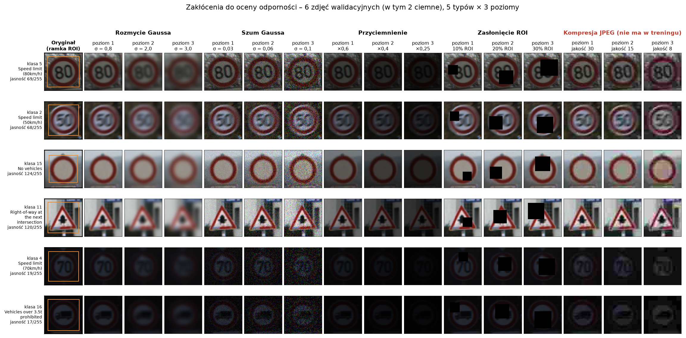
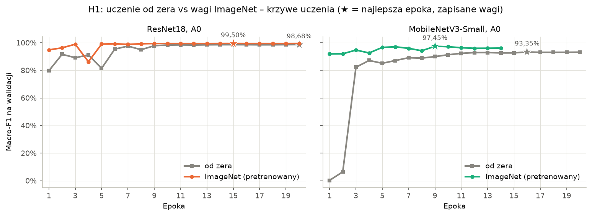
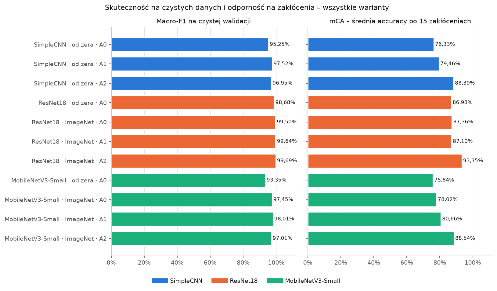
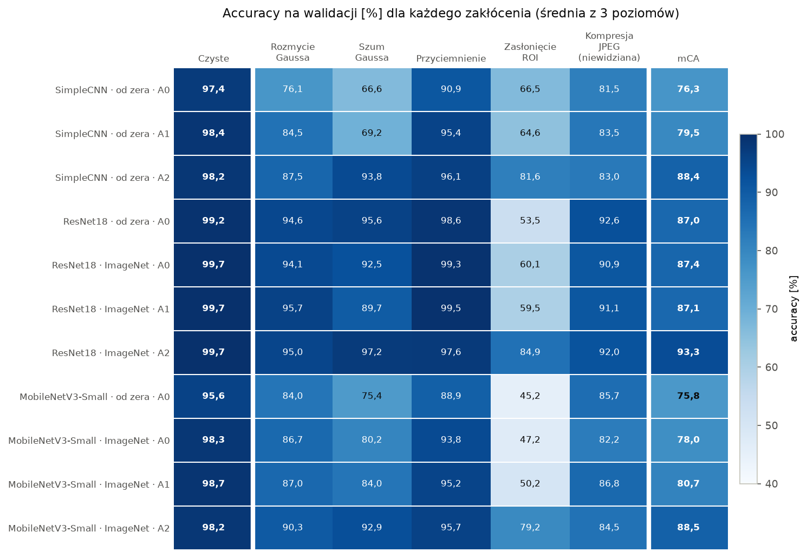
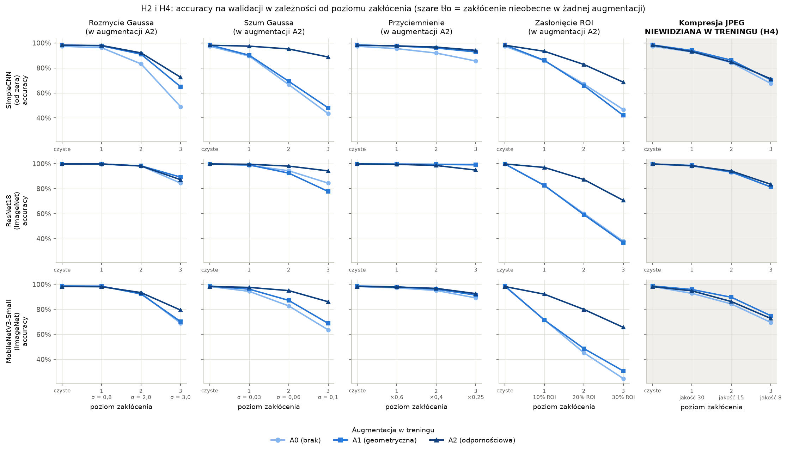
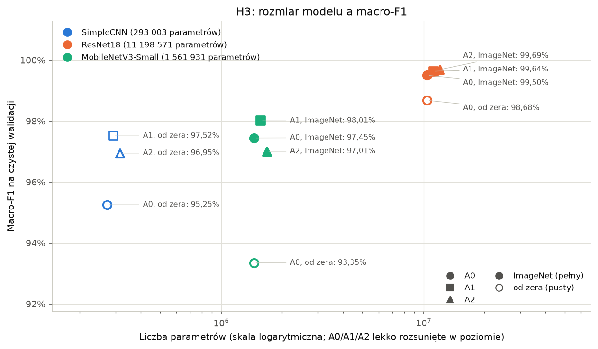

# Sprawozdanie KM2: implementacja rozwiązania i realizacja eksperymentów

## 1. Wprowadzenie

W pierwszym kamieniu milowym postawiłem pytanie, czy uczenie transferowe i odpowiednio dobrana augmentacja ograniczają spadek skuteczności klasyfikatora znaków drogowych na zakłóconych zdjęciach. Przygotowałem wtedy dane, cztery hipotezy (H1 do H4), plan eksperymentów E1 do E4 oraz regułę wyboru najlepszego modelu.

W KM2 zrealizowałem ten plan. Zaimplementowałem modele, zakłócenia, trening i ewaluację, przeprowadziłem wszystkie zaplanowane eksperymenty, zweryfikowałem hipotezy i wybrałem finalny model zgodnie z regułą ustaloną wcześniej. Krótko o tym, co wyszło:

- **wygrał pretrenowany ResNet18 z augmentacją odpornościową A2**: macro-F1 99,73% i mCA 94,96% (średnie z trzech seedów),
- **H1 i H2 się potwierdziły**, H3 i H4 nie,
- najciekawszy wniosek jest taki, że o odporności bardziej decyduje augmentacja niż architektura czy uczenie transferowe.

Wszystkie liczby w tym sprawozdaniu dotyczą zbioru walidacyjnego. Zbiór testowy nadal leży nietknięty i użyję go dopiero w KM3.

## 2. Implementacja

Cały kod jest w katalogu `src/` repozytorium i każdy etap da się uruchomić jednym poleceniem. Zależało mi na tym, żeby eksperymenty były w pełni powtarzalne i żeby nic nie trzeba było klikać ręcznie.

| Moduł | Co robi |
| --- | --- |
| `data.py` | wczytywanie danych, podział po seriach, augmentacje A0/A1/A2 (z KM1) |
| `models.py` | SimpleCNN, ResNet18 i MobileNetV3-Small, od zera albo z wagami ImageNet |
| `corruptions.py` | pięć zakłóceń w trzech poziomach, deterministycznie |
| `train.py` | trening na podstawie pliku konfiguracyjnego, early stopping, zapis historii |
| `evaluate.py` | metryki na czystej i zakłóconej walidacji, czas predykcji na CPU |
| `run_experiments.py` | uruchamia etapy E1 do E4 i sam wybiera warianty według reguł z KM1 |
| `summarize.py` | tabela zbiorcza i wszystkie wykresy z tego sprawozdania |

### 2.1. Modele i adaptacja do małych obrazów

SimpleCNN zbudowałem tak, jak zaplanowałem w KM1: trzy bloki po dwie konwolucje 3×3 z normalizacją wsadową i max poolingiem (32, 64 i 128 kanałów), potem global average pooling, dropout 0,3 i warstwa liniowa. Ma 293 tysiące parametrów.

Przy ResNet18 i MobileNetV3-Small musiałem podjąć decyzję, której nie przewidziałem w KM1. Obie sieci są projektowane pod obrazy 224×224 i zmniejszają je po drodze 32 razy. Przy naszych 64×64 px ostatnia mapa cech miałaby więc rozmiar 2×2, co jest mało i dla samej klasyfikacji, i przede wszystkim dla Grad-CAM w KM3, który pokazałby jedną wielką plamę. Dlatego:

- w ResNet18 ustawiłem krok pierwszej konwolucji na 1 i usunąłem max pooling, dzięki czemu ostatnia mapa ma 8×8,
- w MobileNetV3-Small ustawiłem krok pierwszej konwolucji na 1, co daje ostatnią mapę 4×4.

Zmieniłem tylko kroki, a nie kształty wag, więc wagi pretrenowane na ImageNet ładują się bez żadnych zmian. W obu sieciach podmieniłem ostatnią warstwę na 43 klasy.

| Model | Parametry | Ostatnia mapa cech |
| --- | --- | --- |
| SimpleCNN | 293 003 | 128 × 8 × 8 |
| ResNet18 | 11 198 571 | 512 × 8 × 8 |
| MobileNetV3-Small | 1 561 931 | 576 × 4 × 4 |

### 2.2. Trening

Wszystkie warianty trenowałem w identycznych warunkach: AdamW (lr 0,001, weight decay 0,0001), harmonogram cosinusowy, batch 128, maksymalnie 20 epok i early stopping na macro-F1 walidacji z cierpliwością 5 epok. Zapisywane są wagi z najlepszej epoki.

Do przyspieszenia użyłem treningu w mieszanej precyzji. Na mojej karcie (RTX 4070 Laptop) najszybszy okazał się format bf16 w połączeniu z układem pamięci channels_last: około 1330 obrazów na sekundę dla ResNet18, podczas gdy fp16 dawało zaskakująco słabe 300. Na wynik nie ma to wpływu, a epoka ResNeta trwa około 28 s.

### 2.3. Zakłócenia i ewaluacja

Zakłócenia zaimplementowałem z parametrami z KM1. Losowość (szum, położenie zasłonięcia) zależy od ziarna, numeru zdjęcia, typu i poziomu zakłócenia, więc każdy model widzi dokładnie te same zepsute obrazy. Zasłonięcie to czarny prostokąt o proporcjach ramki ROI, zawsze w całości wewnątrz niej.

Po każdym treningu skrypt liczy metryki na czystej walidacji (accuracy, macro-F1, F1 dla każdej klasy, macierz pomyłek) oraz accuracy dla każdego z 15 zakłóceń, a z nich mCA i względny spadek. Czas predykcji mierzę na procesorze dla pojedynczego zdjęcia (mediana ze 100 powtórzeń po rozgrzewce), na 4 wątkach i dodatkowo na 1 wątku. Przy domyślnych 24 wątkach mały MobileNet wychodził sztucznie wolny, bo narzut na koordynację wątków był większy niż samo liczenie.

Zbiór testowy jest w kodzie zablokowany: ewaluacja na nim wymaga jawnej flagi, którą użyję dopiero w KM3.

### 2.4. Automatyzacja eksperymentów

Skrypt `run_experiments.py` uruchamia kolejne etapy i podejmuje decyzje dokładnie według reguł z KM1. Po E1 sam wybiera warianty do E2, a po E3 stosuje regułę wyboru zwycięzcy. Każdy wybór zapisuje do pliku JSON razem z uzasadnieniem i liczbami (`results/e2_selection.json`, `results/e4_selection.json`). Dzięki temu wybór nie zależy od mojego widzimisię, a każdy krok da się sprawdzić. Przerwany przebieg można wznowić, bo gotowe treningi są pomijane.

## 3. Przebieg eksperymentów

### 3.1. Kontrola zakłóceń przed treningiem

W KM1 zapowiedziałem, że przed pierwszym treningiem obejrzę zakłócone obrazy. Wygenerowałem podgląd dla sześciu zdjęć walidacyjnych, w tym dwóch bardzo ciemnych.

*Rys. 1. Pięć zakłóceń w trzech poziomach na sześciu zdjęciach walidacyjnych. Pomarańczowa ramka w pierwszej kolumnie to ROI.*

Zakłócenia wyglądają tak, jak chciałem. Poziom 1 jest delikatny i znak jest w pełni czytelny, a poziom 3 jest naprawdę trudny: rozmyte cyfry ograniczeń prędkości są nie do odczytania, a 30% zasłonięcia potrafi zakryć połowę liczby. Na dwóch najciemniejszych zdjęciach przyciemnienie na poziomie 3 daje praktycznie czarny obraz, z którym nie poradziłby sobie nawet człowiek. Uznałem, że to w porządku, bo ten poziom celowo wychodzi poza zakres treningu. Parametrów nie zmieniałem.

### 3.2. Treningi

Treningi uruchamiałem w trzech sesjach, bo etapy zależą od siebie (E2 korzysta z wyników E1, a E4 z wyników E2), a krótsze sesje łatwiej było mi zmieścić w ciągu dnia.

| Sesja | Etapy | Treningów | Czas samego treningu |
| --- | --- | --- | --- |
| 1 | E1 | 5 | 46 min |
| 2 | E2 | 6 | 58 min |
| 3 | E3, pomiar czasów, E4 | 2 | 18 min |

Razem 13 treningów i około 2 godziny samego treningu, do tego około 2 minut ewaluacji na każdy model. W KM1 szacowałem całość na około godzinę, ale tamto oszacowanie opierało się na czasie samego wczytywania danych, bez obliczeń sieci. W E4 trenowałem dwa nowe seedy (43 i 44), bo przebieg z seedem 42 już istniał z E2.

### 3.3. Wiarygodny pomiar czasu predykcji

Dokładność modelu nie zależy od tego, co robię na komputerze w tle. Czas predykcji już tak, bo to zwykły pomiar stoperem. Podczas pierwszych dwóch sesji pracowałem obok, więc czasy mierzone zaraz po treningu nie były porównywalne. Testowy pomiar przy włączonych w tle programach dawał dla ResNet18 około 74 ms zamiast 27 ms.

Dlatego dodałem tryb, który mierzy czasy od nowa dla wszystkich gotowych modeli, i uruchomiłem go w sesji 3, na bezczynnym komputerze z zamkniętymi programami, **przed** wyborem zwycięzcy. Wszystkie modele były więc mierzone w jednej sesji i w identycznych warunkach (plan zasilania z maksymalnym stanem procesora 99%, czyli bez trybu turbo). Do sprawozdania i do reguły wyboru trafiły tylko te pomiary.

## 4. E1: architektura i uczenie transferowe

W E1 wytrenowałem pięć wariantów bez augmentacji (A0): baseline SimpleCNN oraz ResNet18 i MobileNetV3-Small, każdy od zera i z wagami ImageNet.

| Model | Inicjalizacja | macro-F1 | Accuracy | mCA | Najlepsza epoka |
| --- | --- | --- | --- | --- | --- |
| SimpleCNN (baseline) | od zera | 95,25% | 97,35% | 76,33% | 16 |
| ResNet18 | od zera | 98,68% | 99,25% | 86,98% | 20 |
| ResNet18 | ImageNet | **99,50%** | **99,67%** | **87,36%** | 15 |
| MobileNetV3-Small | od zera | 93,35% | 95,64% | 75,84% | 16 |
| MobileNetV3-Small | ImageNet | 97,45% | 98,30% | 78,02% | 9 |

*Rys. 2. Macro-F1 na walidacji po każdej epoce, uczenie od zera i z wagami ImageNet. Gwiazdka oznacza najlepszą epokę.*

**Uczenie transferowe wyraźnie pomaga na czystych danych.** ResNet18 z wagami ImageNet ma o 0,82 p.p. wyższe macro-F1, a MobileNet aż o 4,10 p.p. Jeszcze lepiej widać to na krzywych uczenia. Pretrenowany ResNet już po pierwszej epoce miał macro-F1 94,9% (od zera 79,8%) i w trzeciej epoce zbliżył się do 99%, czego wersja od zera nie osiągnęła przez wszystkie 20 epok.

Ciekawie zachował się MobileNet uczony od zera. Przez dwie pierwsze epoki na walidacji praktycznie zgadywał (macro-F1 0,3% i 6,5%), mimo że na treningu miał już ponad 90% accuracy. Dopiero w trzeciej epoce wynik skoczył do 82%. To typowy objaw tego, że na początku treningu statystyki normalizacji wsadowej używane podczas ewaluacji nie nadążają jeszcze za szybko zmieniającymi się wagami. Wersja pretrenowana nie miała tego problemu.

**Zaskoczenie: transfer nie poprawia odporności.** ResNet18 od zera i pretrenowany mają praktycznie identyczne mCA (86,98% i 87,36%). Na silny szum wersja od zera jest nawet wyraźnie lepsza (91,7% wobec 84,4% na poziomie 3). Wagi z ImageNet pomagają więc rozpoznawać czyste znaki, ale nie przygotowują modelu na zakłócenia.

**Wybór do E2.** Zgodnie z regułą do E2 przeszły warianty z wyższym macro-F1 w swojej architekturze, czyli oba pretrenowane: ResNet18 i MobileNetV3-Small.

## 5. E2 i E3: augmentacja i odporność

W E2 wytrenowałem SimpleCNN oraz oba zwycięskie warianty z E1 (pretrenowane ResNet18 i MobileNetV3-Small) z augmentacją A1 i A2. W E3 wszystkie 11 modeli zostało ocenionych na zakłóconej walidacji.

*Rys. 3. Macro-F1 na czystej walidacji (lewo) i mCA, czyli średnia accuracy po 15 zakłóceniach (prawo), dla wszystkich 11 wariantów.*

| Model | Augmentacja | macro-F1 | mCA | Względny spadek |
| --- | --- | --- | --- | --- |
| SimpleCNN | A0 | 95,25% | 76,33% | 21,6% |
| SimpleCNN | A1 | 97,52% | 79,46% | 19,2% |
| SimpleCNN | A2 | 96,95% | 88,39% | 9,9% |
| ResNet18 (ImageNet) | A0 | 99,50% | 87,36% | 12,4% |
| ResNet18 (ImageNet) | A1 | 99,64% | 87,10% | 12,6% |
| ResNet18 (ImageNet) | A2 | **99,69%** | **93,35%** | **6,4%** |
| MobileNetV3-Small (ImageNet) | A0 | 97,45% | 78,02% | 20,6% |
| MobileNetV3-Small (ImageNet) | A1 | 98,01% | 80,66% | 18,3% |
| MobileNetV3-Small (ImageNet) | A2 | 97,01% | 88,54% | 9,9% |

### 5.1. Augmentacja odpornościowa robi ogromną różnicę

A2 podniosła mCA względem A1 we wszystkich trzech architekturach: o 8,9 p.p. w SimpleCNN, o 6,3 p.p. w ResNet18 i o 7,9 p.p. w MobileNet. Względny spadek skuteczności na zakłóceniach zmniejszył się mniej więcej o połowę. Koszt na czystych danych okazał się mały: ResNet18 nawet lekko zyskał (+0,05 p.p.), SimpleCNN stracił 0,57 p.p., a MobileNet równo 1,00 p.p., czyli dokładnie na granicy, którą przyjąłem w hipotezie H2.

*Rys. 4. Accuracy na walidacji dla każdego zakłócenia (średnia z trzech poziomów) i dla każdego wariantu.*

Największy efekt widać przy zasłonięciu, które bez A2 było dla wszystkich modeli najgroźniejszym zakłóceniem. Pretrenowany ResNet18 z A2 rozpoznaje zasłonięte znaki w 84,9% przypadków zamiast 60,1%, a na najsilniejszym poziomie (30% ramki) w 70,6% zamiast 37,9%. Podobnie jest z szumem, gdzie A2 podnosi wynik SimpleCNN z 69% do 94%.

Jedynym zakłóceniem, na którym A2 lekko zaszkodziła, jest przyciemnienie w ResNet18 (97,6% zamiast 99,3%). Bez augmentacji ResNet i tak radził sobie z ciemnymi zdjęciami niemal idealnie, co zgadza się z obserwacją z KM1, że zbiór treningowy jest pełen ciemnych zdjęć.

### 5.2. Augmentacja geometryczna nie daje odporności

A1 poprawiła wynik na czystych danych (najbardziej w SimpleCNN, o 2,3 p.p.), ale w odporności prawie nic nie zmieniła. Pretrenowany ResNet18 ma z A1 praktycznie to samo mCA co bez augmentacji (87,10% wobec 87,36%), a na silny szum jest nawet słabszy (77,8% wobec 84,4%). Wniosek jest prosty: augmentacja uodparnia model na to, co faktycznie symuluje. Obroty i przesunięcia nie przygotują sieci na rozmycie czy zasłonięcie.

### 5.3. Zakłócenie niewidziane w treningu (JPEG)

*Rys. 5. Accuracy w zależności od poziomu zakłócenia dla A0, A1 i A2. Szare tło oznacza kompresję JPEG, której nie było w żadnej augmentacji.*

Na rys. 5 dobrze widać różnicę między zakłóceniami obecnymi w A2 a JPEG. Przy szumie i zasłonięciu ciemna linia A2 wyraźnie odstaje od pozostałych, a przy JPEG wszystkie trzy linie prawie się pokrywają. W liczbach A2 poprawia wynik na JPEG względem A0 tylko o 1,1 do 2,3 p.p., a względem A1 wynik jest niejednoznaczny (ResNet +0,9 p.p., SimpleCNN −0,5 p.p., MobileNet −2,3 p.p.). Odporność nabyta augmentacją praktycznie nie przenosi się więc na nowy rodzaj zakłócenia.

### 5.4. Augmentacja ważniejsza niż architektura

Najciekawszy wynik całego porównania: SimpleCNN z A2, który ma 293 tysiące parametrów, osiągnął wyższe mCA (88,39%) niż pretrenowany ResNet18 bez augmentacji (87,36%), choć jest od niego 38 razy mniejszy. Jeśli chodzi o odporność, dobór augmentacji okazał się ważniejszy niż wielkość sieci i wagi z ImageNet. Najlepszy wynik daje jednak dopiero połączenie obu: mocnej, pretrenowanej sieci i augmentacji A2.

## 6. Rozmiar i szybkość modeli

Hipoteza H3 zakładała, że MobileNetV3-Small osiągnie wynik zbliżony do ResNet18 (różnica macro-F1 poniżej 1 p.p.) przy dużo mniejszym koszcie.

*Rys. 6. Macro-F1 na czystej walidacji w zależności od liczby parametrów (skala logarytmiczna). Pełne znaczniki to modele pretrenowane, puste to uczone od zera.*

| Model | Parametry | Czas predykcji, 4 wątki | Czas predykcji, 1 wątek | Najlepsze macro-F1 | Najlepsze mCA |
| --- | --- | --- | --- | --- | --- |
| SimpleCNN | 0,29 mln | 3,4 do 3,5 ms | 9,5 do 9,9 ms | 97,52% | 88,39% |
| MobileNetV3-Small | 1,56 mln | 5,4 do 6,2 ms | 5,7 do 6,0 ms | 98,01% | 88,54% |
| ResNet18 | 11,20 mln | 26,8 do 27,2 ms | 88,6 do 91,7 ms | 99,69% | 93,35% |

MobileNet jest rzeczywiście dużo tańszy: ma 7 razy mniej parametrów niż ResNet18 i działa około 5 razy szybciej na 4 wątkach oraz około 15 razy szybciej na jednym. Ciekawostką jest to, że MobileNet prawie nie zyskuje na wielu wątkach, bo jest na tyle lekki, że koszt koordynacji wątków zjada zysk z równoległości.

Na wyniku MobileNet jednak traci. Jego najlepsze macro-F1 (98,01%) jest o 1,68 p.p. niższe od najlepszego ResNeta, a najlepsze mCA o 4,8 p.p. niższe. Przekracza to próg 1 p.p. z hipotezy, więc H3 odrzucam. MobileNet byłby rozsądnym wyborem tam, gdzie liczy się każda milisekunda, ale przy zadaniu, w którym chodzi o bezpieczeństwo, ta różnica jest za duża. Warto też zauważyć, że SimpleCNN z A2 ma prawie taką samą odporność jak MobileNet z A2, przy pięć razy mniejszej liczbie parametrów.

## 7. Wybór finalnego modelu i stabilność wyniku

### 7.1. Zastosowanie reguły z KM1

1. **Próg macro-F1.** Najlepsze macro-F1 ma pretrenowany ResNet18 z A2 (99,69%), więc próg wynosi 98,69%. Przechodzą tylko trzy pretrenowane ResNety (A0, A1, A2). ResNet18 uczony od zera odpadł o włos, bo zabrakło mu 0,01 p.p.
2. **Najwyższe mCA.** Spośród trzech pozostałych najwyższe mCA ma wariant z A2 (93,35%), a kolejny (A0) ma 87,36%.
3. **Remis.** Różnica wynosi około 6 p.p., czyli dużo więcej niż próg 0,5 p.p., więc trzeci krok nie był potrzebny.

**Zwycięzcą jest ResNet18 z wagami ImageNet i augmentacją A2.** Wybór jest jednoznaczny i nie zależy od pomiaru czasu.

### 7.2. Stabilność (E4)

Zwycięski wariant wytrenowałem jeszcze dwa razy, z innymi ziarnami losowości, żeby sprawdzić, czy jego wynik nie był szczęśliwym trafem.

| Seed | macro-F1 | mCA | Najlepsza epoka |
| --- | --- | --- | --- |
| 42 | 99,69% | 93,35% | 4 |
| 43 | 99,69% | 95,10% | 11 |
| 44 | 99,81% | 96,43% | 15 |
| **średnia ± odchylenie** | **99,73% ± 0,07** | **94,96% ± 1,55** | |

Wynik na czystych danych jest bardzo stabilny, rozrzut to setne części punktu procentowego. Odporność waha się bardziej, ale nawet najsłabszy seed ma ponad 6 p.p. przewagi nad drugim w kolejności wariantem, więc wybór zwycięzcy jest pewny.

Po E2 miałem wątpliwość, bo przebieg z seedem 42 osiągnął najlepszy wynik już w 4. epoce, a wyniki walidacji mocno skakały między epokami. E4 pokazał coś ciekawego: im później trening się zatrzymał, tym wyższa odporność (93,4%, 95,1% i 96,4% dla najlepszej epoki 4, 11 i 15). Early stopping patrzy tylko na czyste dane, więc może przerwać trening, zanim model zdąży się w pełni nauczyć odporności, którą daje augmentacja. To dobry kandydat na usprawnienie, opisuję go w ograniczeniach.

Do KM3 biorę model z seedem 42, czyli ten, który wygrał w regule wyboru. Jest najsłabszy z trzech pod względem odporności, więc ocena na teście będzie raczej ostrożna niż zawyżona.

## 8. Podsumowanie

### 8.1. Weryfikacja hipotez

| Hipoteza | Wynik | Najważniejsze liczby |
| --- | --- | --- |
| **H1** uczenie transferowe | potwierdzona | macro-F1 +0,82 p.p. (ResNet18) i +4,10 p.p. (MobileNet), wyraźnie szybsza zbieżność; bez zysku w odporności |
| **H2** augmentacja odpornościowa | potwierdzona | mCA +6,3 do +8,9 p.p. względem A1, koszt na czystych danych od +0,05 do −1,00 p.p. |
| **H3** MobileNet bliski ResNetowi | odrzucona | −1,68 p.p. macro-F1 i −4,8 p.p. mCA, w zamian 7 razy mniej parametrów i około 5 razy szybciej |
| **H4** odporność na niewidziany JPEG | raczej odrzucona | zysk tylko 1,1 do 2,3 p.p. względem A0, względem A1 niejednoznaczny |

Na pytanie badawcze odpowiadam więc tak: **odporność klasyfikatora poprawia przede wszystkim augmentacja symulująca konkretne zakłócenia, a uczenie transferowe poprawia głównie skuteczność na czystych danych.** Najlepszy wynik daje połączenie obu, ale odporność obejmuje głównie te zakłócenia, które model widział w treningu.

### 8.2. Ograniczenia

- **Jeden seed dla większości wariantów.** Tylko zwycięzcę trenowałem trzykrotnie. E4 pokazał, że mCA potrafi się wahać o około 1,5 p.p., więc różnice między wariantami mniejsze niż 2 do 3 p.p. traktuję ostrożnie. Główne wnioski (efekt A2, brak efektu A1, przewaga ResNeta) opierają się na dużo większych różnicach.
- **Early stopping na czystych danych.** Kryterium zatrzymania nie uwzględnia odporności, co, jak pokazał E4, może ją zaniżać. Lepszym wyborem byłoby np. kryterium łączące macro-F1 i mCA, ale zmiana reguły po zobaczeniu wyników byłaby nie fair, więc zostawiam ją jako wniosek.
- **Wszystkie wyniki pochodzą z walidacji.** Wybór najlepszej epoki i wariantu na walidacji lekko zawyża wynik. Rzetelna ocena będzie dopiero na zbiorze testowym.
- **Sztuczne zakłócenia.** Są przybliżeniem prawdziwych warunków, a wynik na JPEG pokazuje, że odporność na jedne zakłócenia nie gwarantuje odporności na inne.

### 8.3. Plan na KM3

W KM3 ocenię finalny model (pretrenowany ResNet18 z A2) oraz baseline jeden raz na 12 630 zdjęciach testowych, czystych i zakłóconych. Dodam warstwę wyjaśnialności: mapy Grad-CAM, wskaźnik mówiący, jaka część uwagi modelu przypada na ramkę ze znakiem, oraz analizę błędów. Całość zamknę w aplikacji, w której można wgrać zdjęcie, zobaczyć predykcję z mapą Grad-CAM i na żywo sprawdzić, jak model reaguje na zakłócenia.

## Bibliografia

1. K. He, X. Zhang, S. Ren, J. Sun, *Deep Residual Learning for Image Recognition*, CVPR 2016. [arXiv:1512.03385](https://arxiv.org/abs/1512.03385)
2. A. Howard i in., *Searching for MobileNetV3*, ICCV 2019. [arXiv:1905.02244](https://arxiv.org/abs/1905.02244)
3. D. Hendrycks, T. Dietterich, *Benchmarking Neural Network Robustness to Common Corruptions and Perturbations*, ICLR 2019. [arXiv:1903.12261](https://arxiv.org/abs/1903.12261)
